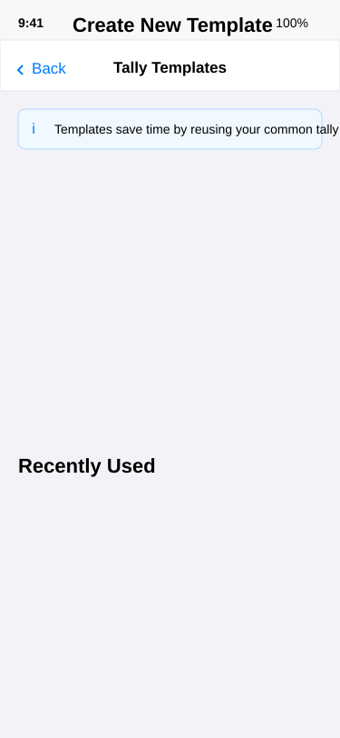
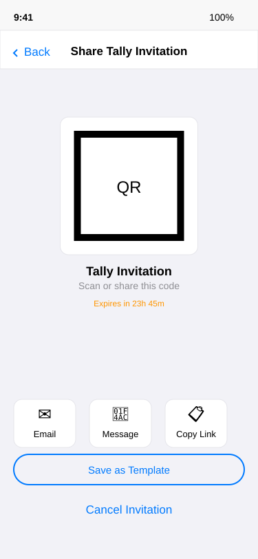

# User Story: First Friend Tally

## Story Overview

**As a** person who has explored MyCHIPs and talked to a trusted friend about it  
**I want to** invite my friend to form our first tally relationship  
**So that** we can start using the MyCHIPs system together  

**Context**: Post-[discovery](onboarding-discovery.md), has basic understanding of MyCHIPs concept, friend is interested and trustworthy, both users ready to experiment with small amounts.

## Sequence

*[Fill in the step-by-step sequence here]*

- User is comfortable now trying his first tally with Friend.
- He remembers the path for inviting others to tally and executes it.
- He is taken to a tally review screen that shows the basic parameters of a tally.
- He sees that this includes how much he trusts Friend, quantified in CHIPs, with amounts also shown in Dollars.
- Following the associated context help, he learns that CHIPs from Friend constitute an IOU and if the friend never makes good, he will lose this value (money).  So he should put in a number small enough that Friend can be trusted to satisfy it or User is prepared to risk/lose it.  He puts in 50.
- He also sees an amount Friend is expected to trust User.  He can fill it in now or leave it blank for Friend to fill in.  He puts in 1000 because he knows he is good for it.
- There are other things in the tally template as well including identifying information about User.  He sees his own name, email and cell info he put in during onboarding.  He also sees blank areas for more identifying information such as address(es) birth date, Tax ID number, Birth Place, document attachments, etc.  They are not checked and they are greyed out so he ignores them for now, but realizes that such information can be included in a tally identity disclosure.
- There is a spot for a comment.  Touching the context help, he learns that he can put anything he wants here so he writes: "Friend, let's tally!"
- There is also a spot for the tally contract.  He doesn't understand that but there is a context help which he briefly visits.  He sees that the contract governs the rights and obligations the parties will have with each other.
- He also sees an option to view the contract.  This brings up a PDF document which he can view, share, print, etc.
- He shares it with his attorney, whom he will email later to ask what he thinks.
- He also notices it is possible to select other tally contracts besides the standard MyCHIPs.org 1.0 default, but he decides to stick with the default.
- He notices there is a checkbox for "Advanced" near the bottom.
- Checking it, he sees more information at the bottom, to include "Trading Variables".  He follows the associated context help to view a tutorial on that subject.  For now, he just leaves them set to their zero defaults.
- He presses the Save button (there was also a Cancel option).
- He is presented with a question: Would you like to save this as a default tally template.  He infers that this might save him a little time on his next tally invitation and so answers: Yes.  He sees a toast: Saving tally template: "Friend, let's Tally!".
- He next sees a QR code, but out of curiosity cancels out and starts over with the tally invitation.
- This time, he sees a list of a single template (the one he previously saved) to select and a big + button he infers to mean "create new".
- He clicks the saved template and is back in the tally review screen.
- He makes a change to the credit limit and pushes Save again.
- He is prompted for an expiration time which defaults to 24 hours.  Pressing a context help, he learns that there is a one-time use token as part of the invitation.  That way only one person can respond using the invitation.  If Friend doesn't respond in time, the token will expire and can not be used by anyone else.
- He accepts the default expiration and now the QR code displaying.  He presses the displayed share icon.
- This takes him to his regular OS share facility.  He decides to use email to send the invitation to Friend.
- He is launched into his email agent, completes the email, which shows the QR code as an attachment as well as a deep link embedded in the email.
- He goes about his business, but after some time, gets a notification on his phone.
- He sees Friend has responded to his tally invitation with a counter-offer.
- He clicks the notification and is launched back into the app and on the tally review screen again.
- He sees that the credit limits are not what he originally entered (50, 1000).  Rather, they now both show as 100.
- He sees buttons at the bottom for Reject, Counter, Accept.
- He modifies the credit limits to both be 75.  The Accept button is now disabled.  He presses Counter.
- He sees a message indicating that his counter offer has been sent to Friend.
- A couple hours later, he gets another notification but this time, the tally has been accepted by Friend.
- Clicking on the notification, he is taken to a similar tally review screen but it now appears read-only--just informational so he can see all the tally terms as before, access the same context helps and details.
- He hits the home button and now sees the tally with friend in his list of tallies.
- Clicking on it, he sees a dialog allowing him to: Pay, Request, View Tally.
- Suddenly he realizes he didn't pay for his share of the last lunch with Friend and so decides to [send some money](send-direct.md) and presses the Pay button.

## Acceptance Criteria

*[Human defines what success looks like for this journey]*

- [ ] Within 3 minutes User has successfully invited a friend to tally
- [ ] A signing key (and thus libp2p identity) has been generated if necessary prior to tally invitation
- [ ] User has access to learning information about keys, tallies risks, contract, etc.
- [ ] Assuming Friend is responsive, a tally is formed and the parties can start tracking credit balances.

---

## Scenarios

### Scenario 1: Both Users Set Up Successfully
*[AI narrative with screen references]*

**David** completed his [discovery journey](onboarding-discovery.md) and is ready to invite his lunch buddy Mike to form a tally.

**Starting from Home**: David opens the app and sees his familiar home dashboard. He taps "Find Tally Partners" from the getting started section.

**Template Selection**: Since David experimented before, he sees his saved template "Friend, let's tally!" in the template list. He could create a new one, but this template has good settings for friends.

**Tally Review & Setup**: David is back in the tally review screen with his template loaded. He adjusts the credit limits to ₡75 mutual trust, adds his personal message, and explores the contract section. He shares the contract with his attorney via email for later review but proceeds with the standard MyCHIPs contract.

**QR Code Sharing**: After saving his settings, David sees the QR code screen. He taps the email icon to send the invitation to Mike. The email includes both a QR code attachment and a deep link. The invitation expires in 24 hours.

**Negotiation Success**: Mike responds with a counter-offer (both limits at ₡100), David counters back to ₡75 each, and Mike accepts. The tally is formed successfully and both users can now transact with each other.

### Scenario 2: Friend Needs Help Installing/Setting Up
*[AI narrative with screen references]*

**Sarah** sends a tally invitation to her neighbor **Tom**, who has never used MyCHIPs.

**Email Response**: Tom receives Sarah's email invitation. When he clicks the deep link, it takes him to mychips.org where he learns he needs to install the mobile app. The deep link preserves the tally invitation context through the app store download.

**Friend's Onboarding**: After installing, Tom goes through the basic identity setup (reusing our existing identity-setup screen) with his name, email, and phone. The app explains this information helps tally partners recognize him.

**Tally Response**: Tom is brought directly to the tally review screen, but now in "response mode" showing Sarah's invitation. He sees she wants to trust him for ₡200 but only wants ₡50 credit back. He reads the context help extensively to understand what credit limits mean.

**Guided Learning**: Tom spends time with the contract viewer and context helps. He realizes this is about managing informal credit between neighbors, not a loan or investment. After understanding the concept, he adjusts the limits to ₡100 mutual and sends his counter-offer.

### Scenario 3: Users Struggle with Tally Terms (Credit Limits, etc.)
*[AI narrative with screen references]*

**Maria** and her business partner **Alex** try to set up a tally but get confused about the credit terms.

**Complex Negotiation**: Maria starts with ₡500 trust for Alex, but ₡2000 credit for herself (reflecting their business relationship where Alex often pays expenses). Alex counters with ₡1000 mutual. Maria counter-offers ₡750/₡1500. The negotiation goes back and forth multiple times.

**Template Confusion**: Maria tries to save different templates but gets confused about which template has which settings. The template list shows her various saved configurations but she can't remember which one was for business vs. personal relationships.

**Resolution Through Education**: After reading more context help and discussing offline, they realize they need asymmetric credit limits that reflect their actual business relationship. They settle on ₡500/₡1500 and add detailed comments explaining the business context.

### Scenario 4: Technical Issues During Tally Creation
*[AI narrative with screen references]*

**Jake** tries to invite his roommate **Chris** but encounters several technical problems.

**Invitation Expires**: Jake creates the tally invitation and shares it via QR code, but Chris doesn't respond within 24 hours. When Chris finally tries to use the link, he gets an error that the invitation has expired.

**Network Issues**: Jake creates a new invitation, but when Chris tries to respond, he has poor network connectivity. His counter-offer fails to send properly, leaving both users confused about the current state.

**Recovery Process**: Jake has to cancel the broken invitation and start over. This time he uses SMS instead of email, and sets a longer expiration time. They also coordinate in person to ensure both have good network connectivity during the negotiation process.

**Success on Third Try**: With better coordination and technical awareness, Jake and Chris successfully complete their tally setup. They learn to communicate outside the app during technical difficulties and use the longer expiration times for complex negotiations.

## Related Journeys

- [Discovery-Driven Onboarding](onboarding-discovery.md)
- [First Payment Between Friends](XX-friend-payment.md)
- [Managing Tally Relationships](XX-tally-management.md)
