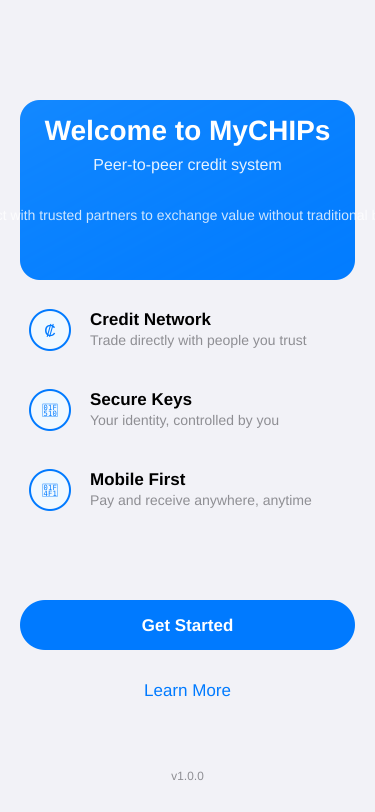
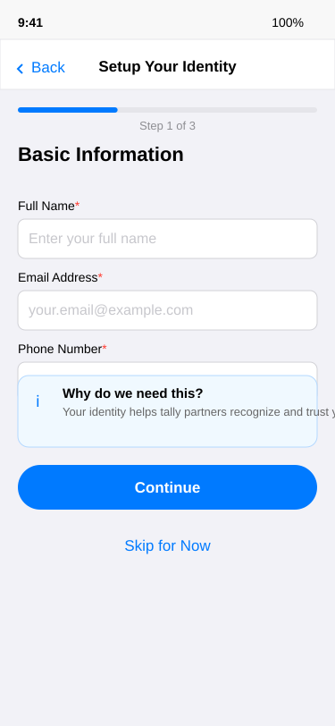
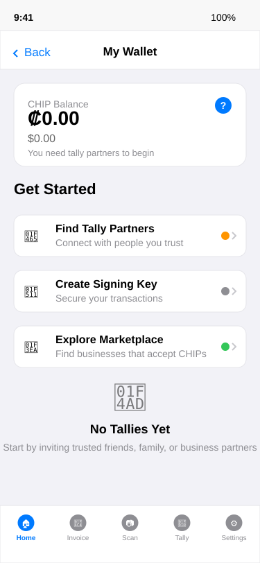

# User Story: Discovery-Driven Onboarding

## Story Overview

**As a** person who has heard about MyCHIPs through media/marketing  
**I want to** download and explore the app to understand what it offers  
**So that** I can decide if it's useful for my needs.

**Context**: Starting from limited knowledge, curious but cautious, understands that MyCHIPs is an alternative payment (i.e. money substitute) system based on peer-to-peer credit, but does not yet how to use the system.

## Sequence

*[Human-defines step-by-step sequence here]*

- User hears about system on a podast, is directed to mychips.org, sees link to download the app.
- User installs app on smartphone and launches it
- Several tasks need to be completed before he can use it for anything useful:
  - Input his identity information.  This is how he will identify himself to others he will tally with.  Name, email and cell number is important for most any potential partner. Some tally partners may ask for more, to possibly include birthdate, drivers license scan, SSN, proof of citizenship, and so forth.  But at this early onboarding phase, he is not given those details.  He can be prompted for more identifying information later if someone demands it.
  - Establish a signing key to be stored securely in the app and accessible only by providing a pass code, biometrics etc.  The user sees (perhaps via a context help) that this can be done now or later just before he tries to execute a tally with someone.
  - Figure out who to tally with.  He can't use MyCHIPs without tally partners.  This should be limited to relationships of pre-existing trust.  He should not tally with strangers and he should only extend credit trusted parties and limited to an amount appropriate to the other party's ability to pay.
- User can see that he has a zero balance (in CHIPs and his local currency) and no existing tally partners.
- He's not really sure what a CHIP is but there is a context help nearby it that takes him to an online resource where he can learn more.
- He can see and explore a basic menu bar that includes at least a Home screen, a QR scanner, and Preferences.
- The user has an option to visit a markeplace web page on mychips.org where he can see vendors who are willing to form tallies with their customers (and/or accept CHIPs indirectly).  He won't really know the difference between tallying or lifting payments to these vendors yet.  But if he clicks on a vendor, he will be taken to a site with QR codes for payment and/or tallying with the vendor.  More will be explained as he explores this.
- User also sees an option to invite others he knows/trusts to tally with him.  This might be friends, family, neighbors, clients, vendors, etc.  
- He clicks it and is prompted with a brief warning about trust and who he should and should not tally with.  There is a context help to learn more detail about this.
- Clicking through, he is told that he will require signing key.  There is a link to learn more about what this means as well.  He follows it to an external resource that gives him the information he needs.
- He is presented with options to import an existing key or create a new one.
- He chooses to create a new one, which is immediately done.
- He is then prompted to export and save the key safely in case he loses his phone or deletes the app.  He is presented with Export Now and Skip.
- He chooses to Skip for now but remembers seeing "Key Management" in the preferences and so will remember to [backup his key](export-signing-key.md) later.
- He sees he is now in a tally review screen but decides to talk to a friend first and will [circle back](first-friend-tally.md) when he is ready to invite his friend to tally.
- This sets him on his journey to start making tallies with others.

## Acceptance Criteria

*[Human defines what success looks like for this journey]*

- [ ] App can be minimally configured (name, email, cell number) in under a minute
- [ ] App defaults to locale settings but user can infer from visual cues that customization settings are possible.
- [ ] User understands that he must execute tallies before further use will be possible.
- [ ] User understands that tallies must only represent/manage independently-existing trust--not be a source of trust.
- [ ] User knows how to use the app to start tallies with trusted partners
- [ ] User knows how to find commercial partners he may recognize who use MyCHIPs

---

## Scenarios

### Scenario 1: Successful Discovery and Setup
*[AI narrative with screen references]*

**Alex** hears about MyCHIPs on a podcast and decides to explore. He visits mychips.org and downloads the app.

**Launch & Welcome**: Alex opens the app and sees an attractive welcome screen explaining MyCHIPs as a "peer-to-peer credit system." The feature highlights (Credit Network, Secure Keys, Mobile First) give him confidence this is legitimate. He taps "Get Started."

**Identity Setup**: Alex sees a clean setup form asking for his name, email, and phone number. The progress bar shows "Step 1 of 3" and the info card explains why this information is needed. He fills in his details quickly and taps "Continue."

**Home Dashboard**: Alex arrives at his main wallet screen showing $0.00 balance in both CHIPs and USD. The "Getting Started" section clearly outlines his next steps: Find Tally Partners (marked as pending), Create Signing Key (optional), and Browse Vendors (ready). He notices the context help icon next to "CHIP Balance" and taps it to learn more.

**Vendor Discovery**: Curious about where he might spend CHIPs, Alex taps "Browse Vendors" which opens the mychips.org marketplace in his mobile browser. He sees local vendors like "Coffee Corner" and "Green Market" with clear indicators showing which accept CHIPs. Some vendor profiles have "Create Tally" buttons that would deep-link back to the app. This helps him understand the ecosystem and see potential partners.

**Return to Setup**: Back on the home screen, Alex taps "Find Tally Partners." He sees the trust warning and explores the context help to understand the importance of only tallying with people he trusts. Realizing he should talk to his friend first, he decides to circle back later. Mission accomplished - he understands the system and knows his next steps.

### Scenario 2: User Gets Confused and Needs Help
*[AI narrative with screen references]*

**Maria** downloads MyCHIPs but struggles with the concepts.

**Launch Hesitation**: Maria sees the welcome screen but doesn't quite understand what "peer-to-peer credit system" means. She taps "Learn More" to read additional resources before proceeding.

**Identity Setup Concerns**: When she reaches the identity setup, Maria is nervous about providing personal information. She reads the info card multiple times and almost taps "Skip for Now" but decides to proceed with minimal information.

**Dashboard Confusion**: On the main dashboard, Maria is confused by the zero balance display. She taps the context help for "CHIP Balance" and reads about CHIPs, but still doesn't fully grasp how she would get them. The "You need tally partners to begin" message helps clarify the dependency.

**Overwhelming Options**: When Maria explores the "Find Tally Partners" option, the trust warnings and technical details about signing keys feel overwhelming. She reads through multiple context helps but still feels uncertain about who to trust and for how much.

**Gradual Understanding**: After browsing vendors on mychips.org and seeing real local businesses, Maria begins to understand how the system might work. She decides to start very small with a family member and plans to learn more before expanding her tally network.

### Scenario 3: User Abandons During Setup
*[AI narrative with screen references]*

**Tom** tries MyCHIPs but doesn't complete the setup.

**Promising Start**: Tom likes the welcome screen and the promise of decentralized payments. The features sound appealing and he eagerly taps "Get Started."

**Setup Friction**: The identity setup feels like "just another signup form" to Tom. He's tired of giving out personal information and considers tapping "Skip for Now" but wants to see the app first.

**Empty State Disappointment**: When Tom sees the zero balance and "You need tally partners to begin" message, he feels frustrated. He was expecting to be able to try the system immediately, similar to other payment apps where you can link a bank account.

**Complexity Overload**: Exploring the "Find Tally Partners" flow, Tom encounters concepts like signing keys, credit limits, and trust relationships. This feels more complex than Venmo or Cash App. He doesn't understand why he can't just add money from his bank account.

**Vendor Discovery Disconnect**: Even browsing vendors on mychips.org doesn't help - Tom doesn't recognize any of the local businesses and realizes he'd need to establish tally relationships before being able to use the system with these vendors.

**Abandonment**: Tom closes the app, planning to "maybe try it later when more people are using it." The learning curve and network effect requirements create too much friction for immediate adoption.

## Related Journeys

- [First Payment Experience](02-onboarding-payment-request.md)
- [Daily Usage Patterns](XX-daily-usage.md)
