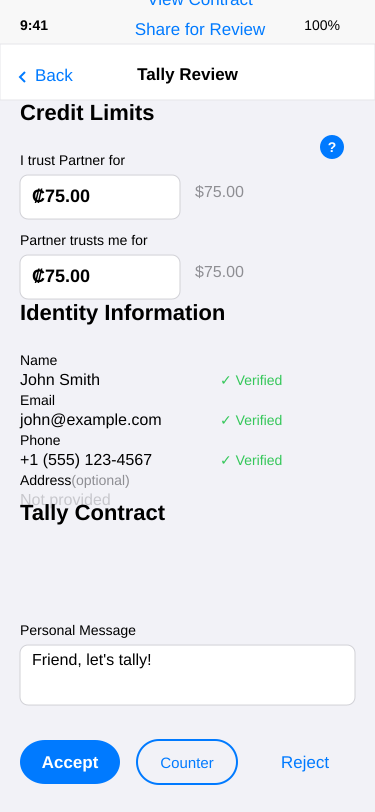

# User Story: Email/Tally Invitation Onboarding

## Story Overview

**As a** person who received a MyCHIPs tally invitation via email  
**I want to** respond to the invitation using the provided link  
**So that** I can pay my begin tracking credit balances with my Partner.

**Context**: My partner [sent me a tally invitation](first-friend-tally.md) via email which I need to respond to.

## Sequence

*[Fill in the step-by-step sequence here]*

- User notices an email from his friend, Partner.
- He clicks on the link and it takes him to the mychips.org website where he learns that in order to use MyCHIPs, he must install the mobile app on his phone.
- He clicks the link and is in the app/play store
- Once installed, the app launches and he finds himself on a screen asking for his Name, email and cell number.
- He fills them out and clicks Done
- He is now in a tally review screen.  He sees a bunch of context helps, which he explores.  
- There are also buttons for Reject, and Accept.
He also sees that Partner has suggested trusting him for 1000 but the trust for User is set at only 50.
- That seems unfair so he edits the two trust levels to both be 100.
- Now the buttons show Reject and Counteroffer.
- He presses Counteroffer and sees that his counteroffer is being sent to Partner.
- Some time later, he gets a notification from Partner
- Clicking on it, he is back in the tally review screen and sees that the credit limits have both been set to 75.
- Seems a fair compromise so he presses Accept and sees that his acceptance is being sent off.
- He clicks the home screen and sees that he still has a zero balance.
- But within minutes, he sees another incoming notice:  He has been paid some CHIPs!
- They show up in the home screen as both a total and also on the tally with Partner.
- Now, where to spend them?

## Acceptance Criteria

*[Human defines what success looks like for this journey]*

- [ ] A party who does not have the app can be invited by someone who does
- [ ] Within minutes the two can have forged a tally between them
- [ ] The journey is self-guided
- [ ] There are plenty of helps evident along the way to get more information and become informed on the implications

---

## Scenarios

### Scenario 1: Smooth Tally Acceptance
*[AI narrative with screen references]*

**Emma** receives a tally invitation email from her friend **Lisa** who completed the [first friend tally](first-friend-tally.md) flow.

**Email to App Store**: Emma clicks the deep link in the email, which takes her to mychips.org and then to the app store. The deep link preserves the tally invitation context through the installation process.

**Quick Identity Setup**: After installing, Emma is guided through the basic identity setup with her name, email, and phone number. The process is streamlined since she's responding to an existing invitation.

**Tally Review & Accept**: Emma is brought directly to the tally review screen showing Lisa's invitation. She sees ₡75 mutual trust, reads the personal message "Friend, let's tally!", and feels comfortable with the terms. She taps "Accept" without changes.

**Immediate Success**: The tally is formed instantly. Emma sees her home dashboard with the new tally relationship and receives her first CHIP payment from Lisa within minutes.

### Scenario 2: Multiple Negotiation Rounds
*[AI narrative with screen references]*

**Carlos** receives a tally invitation from his business partner **Sofia** with asymmetric credit terms he finds unfair.

**Initial Response**: Carlos sees Sofia wants ₡1000 credit but only offers ₡50 back. He reads the context help extensively to understand credit risk and decides this doesn't reflect their equal business partnership.

**Counter-Offer Process**: Carlos adjusts both limits to ₡500 mutual and sends a counter-offer. Sofia responds with ₡750/₡250. Carlos counters again with ₡600/₡400. After three rounds of negotiation and offline discussion, they settle on ₡600 mutual trust.

**Contract Review**: During the negotiation, Carlos shares the tally contract with his business attorney and spends time understanding the trading variables in the advanced section before accepting the final terms.

### Scenario 3: App Installation and Setup Issues
*[AI narrative with screen references]*

**Ahmed** tries to respond to his roommate's tally invitation but encounters technical difficulties.

**Deep Link Problems**: Ahmed clicks the email link on his laptop, but when he installs the app on his phone, the tally invitation context is lost. He has to manually coordinate with his roommate to resend the invitation.

**Identity Setup Confusion**: During identity setup, Ahmed is unsure how much information to provide. He reads the info card multiple times and almost skips the optional fields, but realizes his roommate needs to recognize him.

**Manual Navigation**: After resolving the technical issues, Ahmed has to manually navigate to the tally invitation. His roommate helps by sharing a new QR code in person, which finally connects Ahmed to the correct tally setup screen.

### Scenario 4: User Rejects Tally or Gets Confused
*[AI narrative with screen references]*

**Patricia** receives a tally invitation from an acquaintance **Mark** but decides the relationship isn't appropriate for credit sharing.

**Extensive Research**: Patricia spends significant time reading the contract, exploring context help, and understanding what credit limits mean. She realizes this creates a real financial obligation, not just a casual app connection.

**Thoughtful Rejection**: After consideration, Patricia decides she doesn't know Mark well enough to extend credit. She uses the "Reject" option and the app provides guidance on alternative ways to interact (such as cash payments) until they build more trust.

**Learning Outcome**: Patricia learns about MyCHIPs credit concepts and decides to discuss tally relationships with closer friends and family members instead. The rejection process is respectful and educational rather than dismissive.

## Related Journeys

- [Discovery-Driven Onboarding](01-onboarding-discovery.md)
- [Invoice Management](XX-business-invoicing.md)
